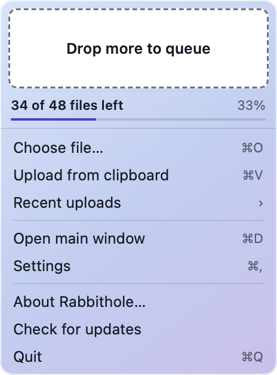
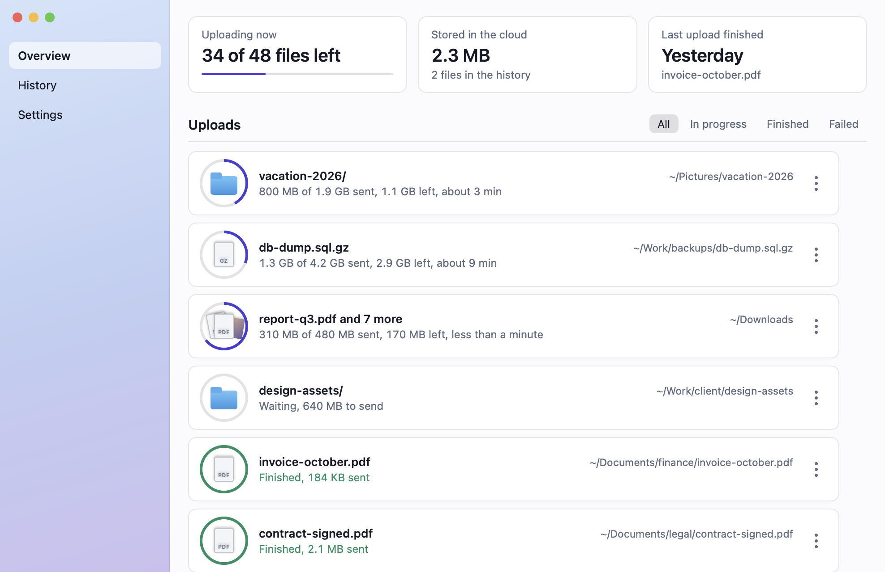
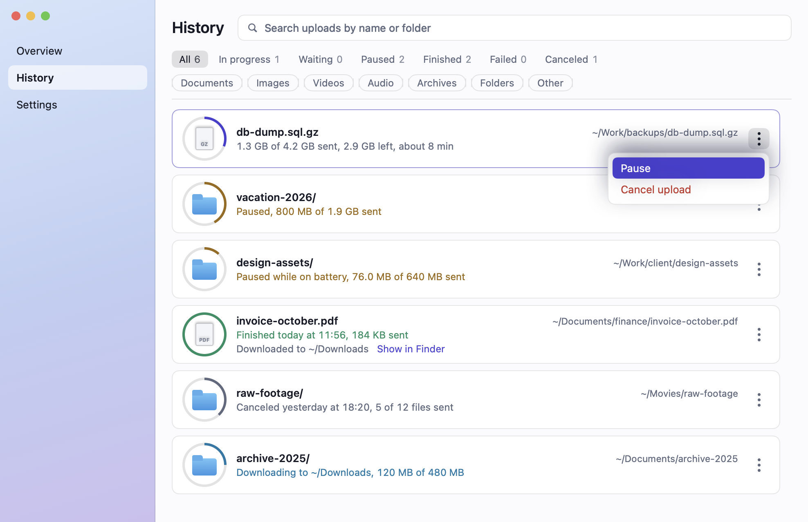
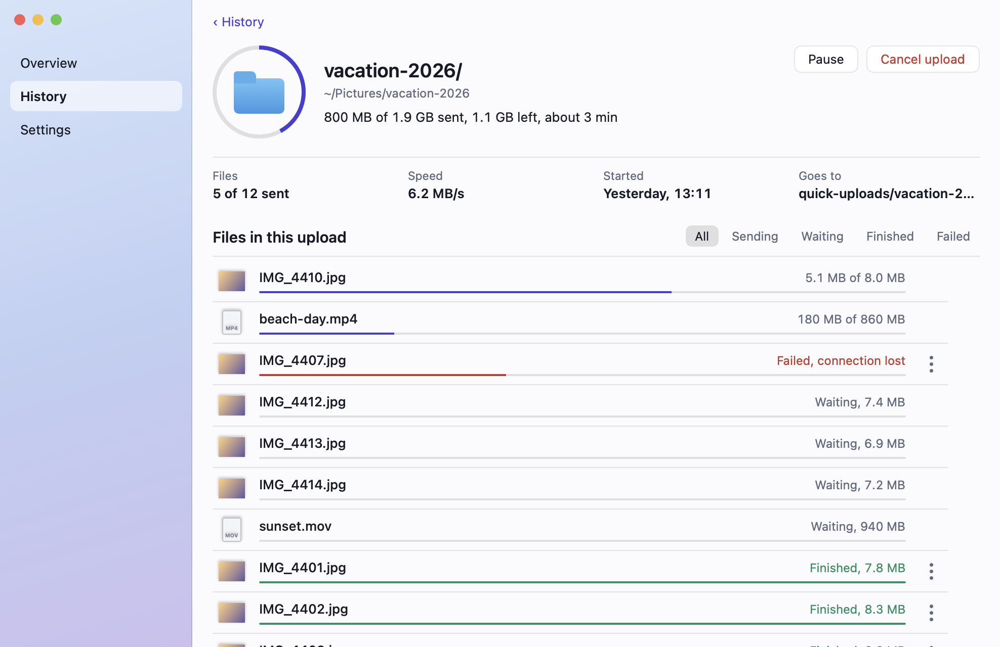
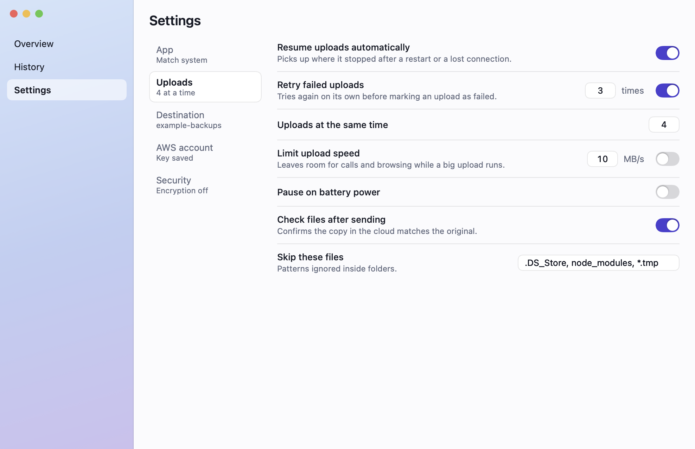

# Rabbithole

Rabbithole is a personal backup tool for macOS. It sends files and folders to an
S3 bucket in your own AWS account and keeps a local history of what it sent. It is
built for one user on one Mac; it is not a hosted service.

## Screenshots

The images are the app's own screens rendered with sample data.

| The window under the menu bar icon | The main window |
|---|---|
|  |  |

| History | One upload |
|---|---|
|  |  |



## What it does

- Uploads files and folders. A folder keeps its structure inside the bucket.
- Groups several items dropped together into one upload.
- Sends files under 16 MiB in one request; larger files go as multipart uploads with 8 MiB parts.
- Sends several files of one upload in parallel.
- Never overwrites an object in the bucket. If the name is taken, a timestamp suffix is added.
- Puts uploads under a configurable folder, `quick-uploads/` by default.
- Keeps a history of its own uploads and checks it against the bucket in the background.
- Pauses, resumes, cancels, retries, downloads and deletes uploads, or single files inside an upload.
- Resumes interrupted multipart uploads from the parts S3 already has.

## How it works

Rabbithole has two processes:

- **Rabbithole.app** is a menu bar app written in Swift (SwiftUI and AppKit), in `app/`.
  It has a small window under the menu bar icon, where you can drop files or folders,
  choose them with a file picker, or send what is on the clipboard (copied files, an
  image or text). It also has a main window with Overview, History and Settings. The
  Dock icon appears only while the main window is open.
- **rabbitholed** is the upload daemon, written in Go, in `daemon/`. The app starts it
  as a child process. The two talk over gRPC on a Unix socket at
  `~/Library/Application Support/Rabbithole/daemon.sock`. The daemon never listens on
  TCP, and it exits when the app goes away. The API is defined in
  `proto/rabbithole/v1/daemon.proto`.

The daemon does the uploads, downloads and bucket calls. The app owns the interface,
the settings and the credentials, which it hands to the daemon over the socket.

## Requirements

- macOS 26.0 or later (the deployment target in `app/project.yml`).
- Swift 6.0 and Xcode, to build the app.
- Go 1.27.4 or later (the version in `daemon/go.mod`). An older Go 1.27 downloads it
  by itself on the first build.
- `xcodegen`, which the build targets use to generate the Xcode project.
- For `make generate` only: `buf`, `protoc-gen-swift` and `protoc-gen-grpc-swift-2`,
  installed with Homebrew. The Go protoc plugins are installed by `make tools`.
- An AWS account, a bucket, and an access key allowed to use it (see below).

## Building and running

All commands run from the repository root.

| Target     | What it does |
|------------|--------------|
| `tools`    | Installs the pinned Go protoc plugins (`protoc-gen-go` v1.36.11, `protoc-gen-go-grpc` v1.6.2) into `daemon/bin/tools`. |
| `generate` | Runs `buf lint` and `buf generate` in `proto/`, writing Go code to `daemon/internal/gen` and Swift code to `app/Sources/Generated`. Depends on `tools`. |
| `daemon`   | Builds the daemon to `daemon/bin/rabbitholed`. |
| `build`    | Builds the daemon, runs `xcodegen generate` and builds the app in Debug into `build/DerivedData`. |
| `test`     | Builds the daemon, runs `go test -race ./...` in `daemon/`, then runs the app's tests with `xcodebuild test`. |
| `run`      | Builds, quits any running Rabbithole, and starts the app in the foreground. |
| `lint`     | Checks the daemon: `gofmt`, `go vet`, and no function over cyclomatic complexity 10 (needs `gocyclo`). |
| `coverage` | Runs both test suites with coverage and writes the reports to `build/coverage`. |
| `package`  | Builds the app in Release with a universal daemon (Apple silicon and Intel) and zips it to `build/Rabbithole.zip`. |

The same targets run on GitHub Actions (`.github/workflows/ci.yml`): quality, tests,
coverage, a security job (`govulncheck` and a secret scan) and the packaged app as a
downloadable artifact. A second workflow runs CodeQL on the daemon.

`make run` keeps the terminal attached to the app, so the daemon's JSON log lines
appear there. The target ends when the app quits.

The daemon writes JSON lines to stderr. Each line has the fields `time`, `level`,
`msg` and `service`. The level is set with `RABBITHOLE_LOG_LEVEL`: `debug`, `info`,
`warn` or `error`. The default is `info`, and an unrecognized value also falls back to
`info`.

## AWS permissions

The access key needs three S3 permissions to upload. Each of the others enables one
function: without it only that function fails, with a message naming the missing
permission.

| Permission                    | Used for                                               | Required or optional |
|-------------------------------|--------------------------------------------------------|----------------------|
| `s3:PutObject`                | Uploading files                                        | Required             |
| `s3:AbortMultipartUpload`     | Cancelling large uploads                               | Required             |
| `s3:ListBucket`               | Checking names and reconciling the history             | Required             |
| `s3:GetObject`                | Downloading files back to your Mac                     | Optional             |
| `s3:DeleteObject`             | Deleting files from the bucket                         | Optional             |
| `s3:ListMultipartUploadParts` | Resuming interrupted large uploads                     | Optional             |
| `s3:ListAllMyBuckets`         | Listing the account's buckets to choose from           | Optional             |
| `s3:CreateBucket`             | Creating a bucket from the app                         | Optional             |

Without `s3:ListAllMyBuckets` you type the bucket name yourself. Without
`s3:ListMultipartUploadParts`, an interrupted multipart upload starts over instead of
continuing from the parts already in S3.

A policy for one bucket that covers uploading, downloading and deleting. Replace
`YOUR-BUCKET` with your bucket name, and leave out `s3:GetObject` or
`s3:DeleteObject` if you do not want the app to download or delete:

```json
{
  "Version": "2012-10-17",
  "Statement": [
    {
      "Sid": "BucketLevel",
      "Effect": "Allow",
      "Action": "s3:ListBucket",
      "Resource": "arn:aws:s3:::YOUR-BUCKET"
    },
    {
      "Sid": "ObjectLevel",
      "Effect": "Allow",
      "Action": [
        "s3:PutObject",
        "s3:AbortMultipartUpload",
        "s3:GetObject",
        "s3:DeleteObject"
      ],
      "Resource": "arn:aws:s3:::YOUR-BUCKET/*"
    }
  ]
}
```

To enable resuming multipart uploads, add `s3:ListMultipartUploadParts` to the
`ObjectLevel` action list. To let the app list buckets or create one, add a statement
with `s3:ListAllMyBuckets` and `s3:CreateBucket` on resource `*`: a bucket that does
not exist yet cannot be named in advance, and a policy limited to `YOUR-BUCKET`
would only allow creating a bucket with that exact name.

## Where things are stored

- **Access key:** the macOS keychain, written by the app. The app passes it to the
  daemon over the socket. It is never written to a file, a log line, an environment
  variable, a command line argument or the database.
- **`~/Library/Application Support/Rabbithole/`**
  - `daemon.sock`: the Unix socket between the app and the daemon.
  - `history.db`: the SQLite database with the upload history. It records only what
    Rabbithole sent.
  - `Clipboard/`: images and text from the clipboard, saved as files so they can be uploaded.

## Project layout

- `app/`: the Swift app. `project.yml` is the xcodegen spec. `Sources/Rabbithole/` holds
  the views and models, grouped into `Main/`, `Tray/`, `Windows/`, `Uploads/`,
  `Settings/` and `System/`. `Sources/Generated/` holds the code generated from the
  proto file. `Tests/` holds the app tests.
- `daemon/`: the Go daemon. `cmd/rabbitholed/` is the entrypoint. `internal/` holds the
  packages:
  - `app`: composes the daemon, parses flags, listens on the socket and shuts down.
  - `awss3`: adapts the AWS SDK for Go v2 S3 client to the uploader.
  - `buckets`: what the daemon does with the buckets of an account.
  - `download`: copies finished files of stored uploads from the bucket to a folder.
  - `gen`: code generated from the proto file.
  - `history`: the upload history in SQLite.
  - `logging`: the structured JSON logger.
  - `queue`: the upload queue: order, pause, cancel, retry and removal, backed by the history.
  - `ratelimit`: the speed limit shared by all uploads.
  - `reconcile`: keeps the history in step with the bucket.
  - `server`: the gRPC API, on top of the queue.
  - `uploader`: uploads of files, single-request and multipart, with checksum verification.
- `proto/`: the gRPC contract (`rabbithole/v1/daemon.proto`) and the `buf` configuration.
- `design/`: `mockups/` holds the approved screen mockups as standalone HTML files;
  `icon/app-icon.svg` is the app icon artwork.
- `docs/`: the design spec and implementation plan of the first version.
- `Makefile`: the build, test and run targets.

## Status and limitations

Rabbithole is a work in progress. These controls appear in the interface but are not
built yet:

- Encryption before sending.
- Automatic retry of failed uploads. Failed uploads can be retried by hand.
- The "Test connection" button.
- "Check for updates".
- "Licenses".

Other limitations:

- The app is signed ad hoc and built locally. There is no notarized or downloadable release.
- macOS only.
